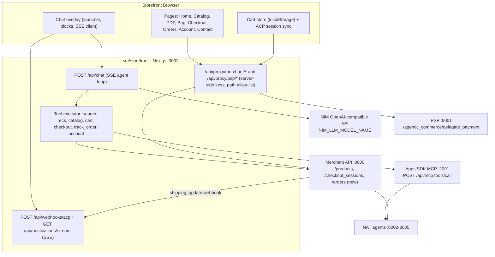
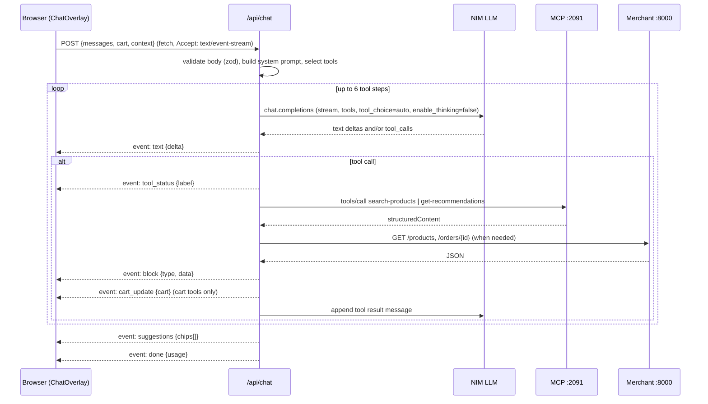
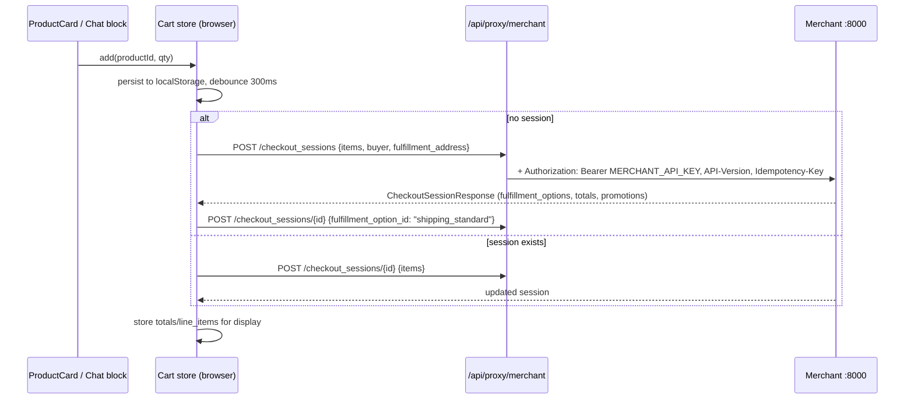
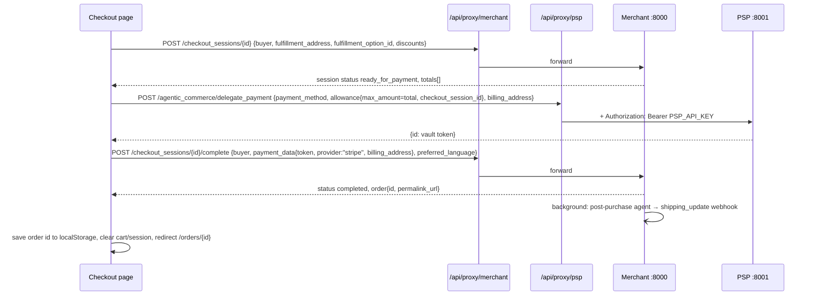
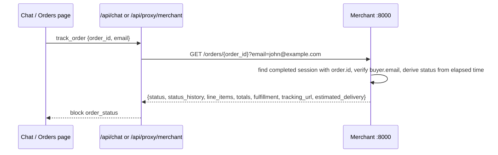
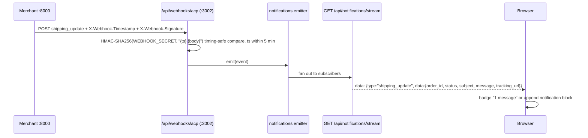

# Feature 18: Matter Storefront + AI Shopping Chat

**Goal**: Ship a consumer-facing storefront (`src/storefront`, Next.js, port 3002) styled after the Matter design system, with an LLM-driven shopping chat overlay that reproduces every Apps SDK widget capability (search, recommendations, cart, ACP checkout, loyalty, post-purchase messages) and adds order tracking — all backed by the existing Merchant API, PSP, Apps SDK MCP server, and NAT agents.

**Status**: ✅ Complete. The apparel catalogue and USD prices described below were replaced by Dubai events in AED; see [Feature 19](./feature-19-dubai-events.md).
**Priority**: P1
**Dependencies**: Features 3, 5, 7, 8, 11, 14, 16
**Design reference**: [Matter Design System](../design/matter-design-system.md)
**Protocol references**: [ACP spec](../specs/acp-spec.md), [Apps SDK spec](../specs/apps-sdk-spec.md)

---

## Table of Contents

1. [Overview, Scope, Non-Goals](#1-overview-scope-non-goals)
2. [Screens and Interaction Spec](#2-screens-and-interaction-spec)
3. [Design System Mapping](#3-design-system-mapping)
4. [Architecture and Sequence Diagrams](#4-architecture-and-sequence-diagrams)
5. [Chat Agent Contract](#5-chat-agent-contract)
6. [Feature Parity Matrix](#6-feature-parity-matrix)
7. [Backend Changes (Merchant API)](#7-backend-changes-merchant-api)
8. [Storefront Project Structure](#8-storefront-project-structure)
9. [Configuration](#9-configuration)
10. [Deployment Wiring](#10-deployment-wiring)
11. [Phased Implementation Plan](#11-phased-implementation-plan)
12. [Acceptance Criteria](#12-acceptance-criteria)
13. [Open Questions and Future Work](#13-open-questions-and-future-work)
14. [References](#14-references)

---

## 1. Overview, Scope, Non-Goals

### Why

The existing UI (`src/ui`, port 3000) is a **protocol inspector** — a three-panel debugging surface for ACP/UCP. The Apps SDK widget (`src/apps_sdk/web`) is a **merchant iframe** meant to be embedded inside a client agent. Neither is a shop a customer would use.

Feature 18 adds a third client: a real storefront whose primary interaction is a conversational assistant. It demonstrates that the same merchant backend (ACP endpoints, PSP delegation, NAT agents, webhooks) can power a first-party retail experience, not just third-party agent integrations.

### Confirmed decisions

| Decision | Choice | Rationale |
|----------|--------|-----------|
| Catalog | Keep the existing 17-product apparel catalog from `src/data/product_catalog.py` | Zero backend data work now; a catalog swap is a single-file edit (see §13) |
| Location | `src/storefront/` inside this repo | Shares deployment scripts, env conventions, quality gates, and the design/docs tree |
| Chat engine | Real LLM client agent with OpenAI-style tool calling (Nemotron via NIM) | Exercises the same model stack the NAT agents use; deterministic fallbacks keep the demo working offline |
| Protocol | ACP only (same as Apps SDK mode) | UCP is exercised by the inspector UI; storefront stays single-protocol |
| Search and recommendations | Call the Apps SDK MCP server tools (`search-products`, `get-recommendations`, `track-recommendation-click`) | They already enrich results and record attribution; avoids duplicating Milvus/NAT client code in TypeScript |
| Cart and checkout | Call ACP endpoints directly through a server-side proxy | The MCP `checkout` tool hardcodes `customer@example.com` and a test card (`src/apps_sdk/tools/checkout.py`), which would break order lookup by email |
| Loyalty / account | Mirror the Apps SDK mock user, pre-authenticated, display-only | Same persona (`user_demo123`) across all three clients |

### In scope

- Storefront pages: Home, Catalog (with category filter), Product Detail, Bag, Checkout, Orders (lookup + detail), Account, Contact.
- Chat overlay with launcher pill, empty state, response cards, structured UI blocks, streaming.
- Agent loop in a Next.js route handler with 10 tools (§5.2).
- Client-side cart mirrored to a single ACP checkout session (same approach as `src/apps_sdk/web/src/checkout-session-sync.ts`).
- ACP checkout: create → update (address, fulfillment, discounts) → PSP delegate → complete.
- Post-purchase `shipping_update` webhook received by the storefront and surfaced as a chat notification.
- Order tracking via a new `GET /orders/{order_id}` Merchant endpoint with deterministic status progression.
- Small Merchant API additions: product list/enrichment, orders endpoint, webhook fan-out.
- Deployment wiring: `install.sh`, `start-nodocker.sh`, `docker-compose.yml`, Dockerfile, env examples, `AGENTS.md`.

### Out of scope (non-goals)

- UCP / A2A transport.
- Real payment processing (PSP remains the simulated vault).
- Real authentication, user registration, password reset.
- Loyalty points redemption at checkout (display only, as in Feature 16).
- Server-side chat history persistence (conversation lives in browser memory for the session).
- Multi-tenant / multi-merchant.
- Changes to the inspector UI (`src/ui`) or the Apps SDK widget beyond shared env/webhook configuration.

---

## 2. Screens and Interaction Spec

Derived from five reference screenshots (1227×768 viewport): Home hero, Home grid scrolled, chat empty state, chat "Track my order" response, chat "kitchen essentials" response with carousels. Measurements below are read from those screenshots and rounded to the 4px grid. Where the screenshots and the [design system](../design/matter-design-system.md) disagree, §3.3 records the resolution. The reference store sells home goods in `C$`; this storefront shows the apparel catalog in USD — layout and behaviour are identical.

### 2.1 Global chrome

**Navigation (fixed, 56px)**
- Full width, 32px horizontal gutter (16px on mobile), content vertically centred.
- Over the hero: transparent background; logo, links and icons white. Once the hero leaves the viewport (`IntersectionObserver` on the hero element): white background, logo `#312e81`, active link `#000000`, inactive links `#666666`, icons `#000000`, 1px bottom border `#f7f7f7`. Colour/background transition `.3s`.
- **Left — logo**: script `m` glyph (`public/logo.svg`) + `Matter` wordmark, Instrument Sans 18px 700, letter-spacing −0.01em. Links to `/`. Wordmark text comes from `NEXT_PUBLIC_BRAND_NAME` (default `Matter`).
- **Centre — links**: `Home` (`/`), `Catalog` (`/catalog`), `Contact` (`/contact`); Instrument Sans 14px 600, 16px gap. Active route is full-contrast, others muted (white at 70% over the hero, `#666666` on white).
- **Right — icons** (20px, 14px gap): search → opens the chat overlay with the composer focused (search is assistant-driven, no separate search page); account → `/account`; bag → opens the bag drawer. The bag icon shows an item-count dot (`#312e81`, white 10px numeral) only when the bag is non-empty — the reference shows an empty bag.
- Mobile (< 640px): centre links collapse behind a menu icon on the left of the logo; the three right icons stay.

**Footer**
- Not visible in the reference screenshots. Keep it minimal: black background, white text, 32px vertical padding (design system prompt #5). One row: logo, `Catalog` / `Contact` / `Orders` links, copyright. No newsletter form.

**Floating chat launcher (all pages, bottom-centre)**
- Horizontally centred, 16px from the bottom edge, `z-index` above page content and the bag drawer.
- Pill: white, 36px tall, padding 8px 16px 8px 12px, radius 100px, shadow `rgba(0,0,0,.15) 0 4px 20px`, no border. Left: 16px orb (radial gradient `#d0cbff` → `#312e81` → `#1e1b4b`, slow 6s breathing animation). Right of orb (8px gap): label Instrument Sans 13px 600 `#000000`.
- Label rotates every 4s with a 200ms cross-fade: `Chat with our AI` → `Find a product` → `Track my order` → `Help me choose`. Rotation pauses on hover/focus.
- **Unread badge**: when an unread notification exists (post-purchase webhook arrived while the overlay was closed), a tooltip-style chip sits 6px above the pill, centred: `1 message` (or `N messages`), background `rgba(0,0,0,.65)`, white 11px 600, padding 3px 10px, radius 100px, with a 6px downward caret. Clears when the overlay opens.
- Click → opens the chat overlay (§2.11). Keyboard: `Cmd/Ctrl+K` toggles; `Esc` closes. Hidden on `/checkout` while a payment is in flight.

### 2.2 Home (`/`)

1. **Hero** — full-bleed image starting at `y = 0` (the nav overlays it), height `clamp(480px, 72vh, 640px)`, `object-fit: cover`, `object-position: center`. The reference image carries its own warm-beige → deep-indigo gradient; add a legibility overlay `linear-gradient(180deg, rgba(0,0,0,0) 55%, rgba(0,0,0,.35) 100%)`. Bottom-aligned content, 32px inset:
   - **Bottom-left**: eyebrow `Introducing` — Instrument Serif *italic* 24px, white; headline `Our Newest Arrivals` — Instrument Serif 400 44px (36px tablet, 30px mobile), white, line-height 1.1, 4px below the eyebrow.
   - **Bottom-right**: paragraph max-width 380px, Instrument Sans 14px, line-height 1.4, white: `Curate a space that feels like home. Our handcrafted pieces bring warmth, order and a touch of quiet luxury to your day.` On mobile it stacks under the headline.
   - **No CTA buttons** in the hero (reference has none). Copy and image path come from `lib/content/home.ts` so the catalog swap (§13) can replace them in one place.
2. **"Curate Your Space." grid** — 32px top padding; section title Instrument Sans 17px 600 `#000000` (not serif — see §3.3); 16px below it the product grid (§2.3): 4 columns ≥ 1024px, 3 at 768–1023px, 2 below, 8px gap, 32px page gutter. Shows the full `GET /products` result (17 items; reference shows ≥ 8). Infinite/paged loading is not needed at this catalog size.

### 2.3 Product card (grid item)

- Card: `#f7f7f7` background, radius 10px, `overflow: hidden`, no border. Entire card is a link to `/products/{id}`.
- **Image**: square (`aspect-ratio: 1/1`), fills the card width, `object-fit: cover`; the product photo supplies its own backdrop. Hover: image `scale(1.03)` over `.25s ease-out`, card `translateY(-4px)`, shadow `rgba(0,0,0,.15) 0 4px 20px`.
- **Sale badge** (only when `compare_at_price` is present): bottom-left of the image, 8px inset. White background, `#312e81` text `Sale`, Instrument Sans 11px 600, padding 3px 8px, radius 6px.
- **Text block**: padding 12px 12px 16px. Name — Instrument Sans 15px 600 `#000000`, single line with ellipsis. Price row 4px below — current price `$65.00` 13px 600 `#000000`; when on sale, `compare_at_price` follows with 6px gap in 12px `#666666` `line-through`. No percentage chip on grid cards (the `NN% OFF` chip is chat-carousel only, §2.11).
- No add-to-bag control on the card (reference has none); adding happens on the PDP, in the chat carousel, or through the assistant.

### 2.4 Catalog (`/catalog`, `/catalog?category=…`)

- Same chrome and grid as Home minus the hero; page starts with 56px top offset for the fixed nav.
- Title row (Instrument Sans 17px 600): `Catalog` or the category label (`Tops`, `Bottoms`, `Outerwear`, `Footwear`, `Accessories`), followed on the same row by filter chips: `All` + five categories, mapped to `GET /products?category=…`. Active chip `.btn-pill` (indigo), inactive `.btn-outline`. Right-aligned sort select: `Featured`, `Price: low → high`, `Price: high → low` (client-side).
- Grid identical to §2.3. Empty state copy: `Nothing here yet — try another category or ask the assistant.` with a `Chat with our AI` pill.

### 2.5 Product detail (`/products/[id]`) — not in reference; derived from the design system

- Two-column (stacked on mobile): image left (square, radius 10px, sticky on desktop), details right, 32px gutter, 56px top offset.
- Title Instrument Serif 32px; price row as in §2.3 plus `-NN%` in `#312e81` 13px when on sale; `description` paragraph 16px `#000000`; `attributes` as `.btn-outline` chips (13px).
- Quantity stepper (`−` / `1` / `+`, 40px targets, `.btn-primary` style) + `Add to bag` `.btn-pill`. Stock copy: `In stock` or `Only N left` when `stock_count < 10`.
- **You might also like** — horizontal row of 3 tiles in the chat-carousel tile style (§2.11) from MCP `get-recommendations` with `productId`/`productName` of the current product and the current cart. Each tile shows the agent's `reasoning` as a 12px `#666666` caption. Click records `track-recommendation-click` with `source: "storefront_pdp"`.

### 2.6 Bag (`/bag`) and bag drawer

- Drawer slides in from the right (420px, full-width on mobile) when `Add to bag` is clicked; `/bag` is the same content as a page.
- Line items: thumbnail, name, unit price, stepper, remove (`✕`). Totals block mirrors the ACP session `totals` array (`items_base_amount`, `items_discount`, `subtotal`, `fulfillment`, `tax`, `total`) and shows promotion text from `line_items[].promotion` when present.
- Discount code input → ACP `discounts.codes`. Shipping selector (`Standard Shipping — $5.99`, `Express Shipping — $12.99`) → `fulfillment_option_id`.
- Primary CTA `Checkout` → `/checkout`. Secondary `Ask about my bag` → opens chat with prefilled prompt.
- A quiet status line shows ACP sync state: `Synced to session checkout_…` / `Syncing…` / `Offline — will retry`.

### 2.7 Checkout (`/checkout`)

- Single page, two columns (form left, summary right). Prefilled from the signed-in mock user: `John Doe`, `john@example.com`, default address `123 AI Boulevard, San Francisco, CA 94102, US` (same defaults as `checkout-session-sync.ts`).
- Steps rendered as sections, not a wizard: Contact → Shipping address → Delivery option → Payment → Review.
- Payment: card form (number, expiry, CVC, name). In demo mode (`NEXT_PUBLIC_DEMO_PREFILL=true`) the PSP test card is prefilled. Card data goes **browser → `/api/proxy/psp` → PSP**; it is never sent to `/api/chat`.
- `Place order` pill. On success: redirect to `/orders/{order_id}?email=…` with a confirmation banner, and the chat launcher badge increments when the `shipping_update` webhook arrives.

### 2.8 Orders (`/orders`, `/orders/[orderId]`)

- `/orders`: lookup form (`Order ID`, `Email` prefilled with the mock user's email). Submits to `GET /api/proxy/merchant/orders/{id}?email=…`.
- `/orders/[orderId]`: status timeline with four nodes — `Order confirmed`, `Shipped`, `Out for delivery`, `Delivered` — mapping 1:1 to `ShippingStatus` values. Current node filled `#312e81`; past nodes `#d0cbff`; future nodes `#efefef`. Shows `estimated_delivery`, carrier, `tracking_url` link, line items, totals, ship-to address.
- `Ask about this order` → opens chat with `Where is order {id}?`.

### 2.9 Account (`/account`) — reached from the nav user icon

- Loyalty card: name, tier badge (`Gold`), points (`1,250`), member since (`March 2024`). Copy: `Points redemption coming soon`.
- Recent orders list is populated from browser `localStorage` (order IDs saved on successful checkout); each links to `/orders/[orderId]`. A `Track another order` link goes to `/orders` (Orders is not in the top nav; it is reachable here, from the footer, and via the chat).
- Sign-out is a no-op button with tooltip `Demo account`.

### 2.10 Contact (`/contact`)

- Static page: support email, hours, a `Chat with us` pill that opens the overlay.

### 2.11 Chat overlay

The overlay is a **full-viewport takeover**, not a side panel. The page stays mounted underneath and is blurred; the launcher pill is hidden while open.

**Open/close**
- Opens from the launcher, the nav search icon, `Cmd/Ctrl+K`, any `Chat with our AI` / `Ask about …` button, or a deep link `?chat=<prompt>`.
- Backdrop: `position: fixed; inset: 0`, `backdrop-filter: blur(28px)` applied to the page wrapper (fallback: a blurred snapshot via `filter: blur()` on the page root), plus a `rgba(0,0,0,.2)` scrim so white text stays legible over white page regions (§3.3). Body scroll locked; focus trapped; `role="dialog"`.
- Close button: white 32px circle with a 14px `×`, shadow `rgba(0,0,0,.15) 0 4px 20px`, top-right 32px/32px in the empty state; in the response state it sits 16px above the card, aligned to the card's right edge. `Esc` closes. Open/close animates opacity + blur over `.3s`.
- Conversation state (messages, cards, scroll position) persists in memory across open/close within a page session, and in `sessionStorage` across client-side navigation.

**Empty state** (no turns yet; also reachable via the back control)
- A single column, 353px wide, horizontally centred and anchored toward the bottom of the viewport: the composer sits 24px above the bottom edge and the greeting group stacks above it. On short viewports the group scrolls.
- From top to bottom: orb 36px (same gradient as the launcher, breathing); 20px gap; greeting `Hi, how can I help you?` — Instrument Sans 17px 600, white, centred; 16px gap; suggestion chips; 24px gap; composer.
- **Suggestion chips**: wrap and centre, 6px row/column gap. Chip: `rgba(255,255,255,.18)` background with `backdrop-filter: blur(8px)`, white 13px 500 text, 14px leading icon, padding 6px 12px 6px 10px, radius 100px; hover `rgba(255,255,255,.28)`. Five chips, in this order (icons from `lucide-react`):
  1. `Help me choose` — `sparkles`
  2. `Track my order` — `truck`
  3. `Suggest essentials for a weekend trip` — `search`
  4. `Recommend a gift for a runner` — `search`
  5. `What goes with the Classic Tee?` — `list`
  Chip copy lives in `lib/agent/intents.ts` with the tool mapping (§5.6) so each chip works without an LLM key.

**Composer** (same component in both states)
- White pill 353px × 40px (full width minus 32px on mobile), radius 100px, shadow `rgba(0,0,0,.15) 0 4px 20px`, padding 0 12px. Left: 16px `search` icon `#666666`. Middle: single-line input, Instrument Sans 14px, placeholder `#666666`. Right: 16px `mic` icon `#312e81` — visual only in v1 (tooltip `Voice coming soon`); a send arrow replaces the mic once the input is non-empty.
- Placeholder is contextual: empty state `What can I help you with today?`; after an `order_form`/`order_status` card `Need more details?`; after a `product_carousel` card `What else would you like to know?`; after a `cart_summary`/`checkout_panel` card `Anything else for your bag?`; otherwise `Ask a follow-up…`.
- `Enter` sends; input is disabled with a subtle pulse while a turn is streaming.

**Response card state** (one card visible at a time)
- Card: white, 640px wide (viewport minus 32px on mobile), centred, top at 134px (below the controls row), radius 16px, shadow `rgba(0,0,0,.15) 0 5px 30px`, `height: clamp(420px, calc(100vh - 270px), 560px)`, padding 20px, **internal scroll** (`overflow-y: auto`, thin scrollbar). The composer sits 16px below the card.
- **Controls row** (16px above the card, aligned to its edges): left — a white pill 46px × 26px containing a 12px `‹` chevron and a 14px orb; clicking it steps back to the previous turn's card, and from the first turn back to the empty state (`aria-label="Previous"`). Right — the close circle. Stepping back does not delete history; the next message continues the same conversation.
- **Card body**:
  - Title — the user's prompt or chip label, Instrument Sans 17px 600 `#000000`, 12px below the top padding.
  - Assistant text — Instrument Sans 14px, line-height 1.5, `#000000`, paragraphs 12px apart, streamed token-by-token. Minimal markdown: bold, lists, line breaks; no links or HTML.
  - Zero or more **blocks** (§5.4) interleaved with text in the order emitted. Blocks may be preceded by a **section heading**: Instrument Sans 15px 600 + optional subtitle 12px `#666666` 2px below (e.g. `Cooking and prep essentials` / `Tools that make every meal better` → in this catalog `Layers for cooler days` / `Outerwear picks for the week`). The LLM supplies the heading via the block's `title`/`subtitle`.
  - **Product carousel block**: horizontal scroll row (`scroll-snap-type: x mandatory`), tiles 134px wide, 8px gap, bleeds to the card's right padding edge (`margin-right: -20px`). Tile: image 134×134 radius 8px `object-fit: cover`; 8px gap; name 13px 600 single-line ellipsis; price row 12px: current (`From $29.00` when variants exist, otherwise `$29.00`) `#000000`, compare price `#666666` strikethrough, then a `NN% OFF` chip — `#e3f3e8` background, `#178a3c` text, 10px 700, padding 2px 6px, radius 4px. A 32px white circular `›` button with shadow floats at the card's right edge, vertically centred on the tiles, scrolling one viewport; a mirrored `‹` appears once scrolled. Tile click → `/products/{id}` (overlay closes, state retained). On hover/focus a 12px `Add to bag` text link in `#312e81` appears under the price (not in reference — documented in §3.3).
  - **Order form block** (reference "Track my order"): intro text, then a 36px-tall input group 333px wide — `Order number` | `Email address` cells separated by a 1px `#e5e5e5` divider, group border 1px `#e5e5e5`, radius 8px, 13px text, placeholders `#666666` — followed by an outline button `Track Order ›` (same height, border 1px `#e5e5e5`, radius 8px, `#312e81` 13px 600, padding 0 16px). Email is prefilled from the mock user when empty. Submit → `track_order` turn.
  - **Order status block**: horizontal four-node timeline (`Order confirmed`, `Shipped`, `Out for delivery`, `Delivered`), node colours as in §2.8, then a two-column detail list (carrier, tracking link, estimated delivery, items, total) in 13px.
  - **Cart summary / checkout panel / account summary / notification blocks**: `#f7f7f7` panels, radius 10px, padding 16px, 13px text; primary actions use `.btn-pill`, secondary `.btn-filled`.
  - **Feedback** — 16px thumbs-up / thumbs-down icons `#666666`, 16px below the last block, 12px apart; selected state `#312e81`. Logged to the console/analytics stub only.
  - **Follow-up chips** — when the agent returns `suggestions`, render them below the feedback row as `.btn-outline` chips (13px).

**Streaming behaviour**
- The card appears as soon as the turn starts (title + skeleton). While a tool runs, a 13px `#666666` status line with a 12px spinner shows the tool's `invoking` label (`Searching the catalog…`, `Finding recommendations…`, `Checking your order…`); it is replaced by the tool's block when it lands.
- Stream error → inline 13px error in `#000000` on a `#f7f7f7` panel with a `Retry` `.btn-outline` chip; the fallback router (§5.6) answers the retry.

**Notifications**
- When `/api/webhooks/acp` receives `shipping_update`, the server emits it on the notifications SSE stream. If the overlay is closed, the launcher shows the `1 message` tooltip badge. If open, a new card is pushed titled with the webhook `subject`, containing a `notification` block (`message`, status pill, `View order` → `/orders/{order_id}`), and the back control lets the user return to the previous card.

---

## 3. Design System Mapping

Source: [docs/design/matter-design-system.md](../design/matter-design-system.md). Implemented as Tailwind v4 `@theme` tokens in `src/storefront/app/globals.css`.

### 3.1 Tokens

```css
@import "tailwindcss";

@theme {
  /* Colors */
  --color-bg: #ffffff;
  --color-text: #000000;
  --color-text-secondary: #666666;
  --color-border: #f7f7f7;
  --color-surface: #f7f7f7;
  --color-surface-strong: #efefef;
  --color-primary: #312e81;
  --color-primary-soft: #d0cbff;
  --color-primary-tint: #d9d4ff;
  --color-line: #e5e5e5;          /* chat form borders (reference) */
  --color-deal-bg: #e3f3e8;       /* NN% OFF chip, chat carousel only (reference) */
  --color-deal-text: #178a3c;
  --color-badge-dark: rgba(0, 0, 0, 0.65); /* "1 message" tooltip */
  --color-glass: rgba(255, 255, 255, 0.18); /* chips over the blurred backdrop */
  --color-scrim: rgba(0, 0, 0, 0.2);

  /* Typography */
  --font-serif: "Instrument Serif", ui-serif, Georgia, serif;
  --font-sans: "Instrument Sans", ui-sans-serif, system-ui, sans-serif;
  --text-hero: 44px;
  --text-hero--line-height: 1.1;
  --text-eyebrow: 24px;
  --text-h2: 32px;
  --text-title: 17px;             /* section titles, chat greeting, card title */
  --text-body-l: 18px;
  --text-body: 16px;
  --text-small: 14px;
  --text-caption: 13px;
  --text-micro: 12px;

  /* Radii */
  --radius-badge: 4px;
  --radius-sale: 6px;
  --radius-input: 8px;
  --radius-tile: 8px;
  --radius-card: 10px;
  --radius-panel: 16px;
  --radius-pill: 100px;

  /* Shadows */
  --shadow-float: rgba(0, 0, 0, 0.15) 0px 4px 20px 0px;
  --shadow-deep: rgba(0, 0, 0, 0.15) 0px 5px 30px 0px;

  /* Motion */
  --ease-hover: ease-out;
  --duration-hover: 0.25s;
  --duration-surface: 0.3s;
  --hover-lift: 4px;
  --hover-scale: 1.03;
  --blur-overlay: 28px;

  /* Layout */
  --spacing: 4px; /* Tailwind base; 16px = 4 units, grid gap 8px = 2 units */
  --nav-height: 56px;
  --container-page: 120rem;
  --container-content: 42rem;
  --chat-card-width: 640px;
  --chat-composer-width: 353px;
}
```

Fonts load with `next/font/google` (`Instrument_Serif` 400 normal + italic, `Instrument_Sans` 400/500/600/700) and are exposed as CSS variables consumed by `--font-serif` / `--font-sans`. Icons: `lucide-react` (`search`, `user`, `shopping-bag`, `sparkles`, `truck`, `list`, `mic`, `x`, `chevron-left`, `chevron-right`, `thumbs-up`, `thumbs-down`).

### 3.2 Component mapping

| Design system component | Storefront usage | Tailwind recipe |
|---|---|---|
| `.btn-pill` (`#312e81`, white, 100px) | Primary CTAs: `Checkout`, `Place order`, active catalog filter, `Go to checkout` in chat | `rounded-pill bg-primary text-white px-6 py-3 text-small font-semibold` |
| `.btn-primary` (`#efefef`, black, 100px) | Secondary CTAs: `Continue shopping`, stepper buttons | `rounded-pill bg-surface-strong text-text px-6 py-3` |
| `.btn-outline` (1.6px rgba(0,0,0,.15), 50px) | Inactive catalog filters, follow-up chips, `Retry`, PDP attribute chips | `rounded-pill border-[1.6px] border-black/15 px-4 py-2 text-caption` |
| `.btn-filled` (`#f5f5f5`, `#312e81`, 6px) | `View order` in notifications, secondary actions inside chat panels | `rounded-sale bg-[#f5f5f5] text-primary px-2.5 py-1 text-caption font-semibold` |
| `.btn-ghost` (transparent, white, 600) | Nav links over the hero | `text-white/70 font-semibold [&.active]:text-white` |
| `.card` (`#f7f7f7`) | Product card, chat panels (cart/checkout/account/notification) | `rounded-card bg-surface overflow-hidden` |
| High shadow | Launcher pill, composer, close/back controls, bag drawer | `shadow-float` |
| Deep shadow | Chat response card | `shadow-deep` |
| — (reference only) | `Sale` badge on grid cards | `absolute bottom-2 left-2 rounded-sale bg-white text-primary px-2 py-[3px] text-[11px] font-semibold` |
| — (reference only) | `NN% OFF` chip in chat carousel | `rounded-badge bg-deal-bg text-deal-text px-1.5 py-0.5 text-[10px] font-bold` |
| — (reference only) | Glass suggestion chips | `rounded-pill bg-glass backdrop-blur-sm text-white px-3 py-1.5 text-caption font-medium hover:bg-white/30` |
| — (reference only) | `1 message` tooltip badge | `rounded-pill bg-badge-dark text-white px-2.5 py-[3px] text-[11px] font-semibold` + 6px caret |
| — (reference only) | Chat inline input group / outline button | `rounded-input border border-line h-9 text-caption` |

### 3.3 Deviations and resolutions

| Element | Reference screenshot | Extracted design system | Decision |
|---|---|---|---|
| Green `NN% OFF` chip (chat carousel) | Muted green pill | No green in palette; "don't add saturated colors" | **Follow reference** with low-saturation tokens `#e3f3e8` / `#178a3c`, used only in chat carousel tiles. Grid cards show strikethrough only, exactly as in the reference |
| `Sale` badge | White pill, indigo text, bottom-left of image, radius ~6px | N/A | **Follow reference** (replaces the earlier `#d9d4ff` idea) |
| `1 message` badge | Dark translucent tooltip above the launcher | "Don't use dark backgrounds" | **Follow reference**; it is a 20px chip, not a surface. Token `--color-badge-dark` |
| Launcher position | Bottom-centre | N/A | **Follow reference** (bottom-centre, 16px from edge) |
| Section titles (`Curate Your Space.`), chat greeting, card titles | Instrument Sans ~17px 600 | Headings in Instrument Serif | **Follow reference**: serif reserved for hero eyebrow/headline and PDP title |
| Hero | Image carries its own beige→indigo gradient; no buttons | Palette has no dark page backgrounds | Image overlay only (`rgba(0,0,0,0)→.35` at bottom) for legibility; no CTAs |
| Product card radius / grid gap | ~10px / 8px | 6px / 16px grid | **Follow reference** for product cards and grid; 16px grid everywhere else; 6px kept for `.btn-filled` and `Sale` |
| Chat overlay | Full-screen blur, almost no scrim, white text | N/A | Follow reference, plus a `rgba(0,0,0,.2)` scrim so the white greeting/chips remain legible when the overlay opens over white page regions |
| `Add to bag` on carousel tiles | Absent | N/A | Add a hover/focus-only 12px text link so a purchase can complete inside the chat; the assistant's `add_to_cart` tool is the primary path |
| Mic icon in composer | Present | N/A | Rendered, non-functional in v1 (tooltip). Web Speech API is listed in §13 |
| Currency | `C$` | N/A | `$` USD — Merchant totals are USD cents |
| Footer | Not shown | Prompt #5 suggests black footer | Keep a minimal black footer |
| Order timeline colours | Not shown | N/A | Current `#312e81`, past `#d0cbff`, future `#efefef` |

### 3.4 Type usage

- Instrument Serif: hero eyebrow (`Introducing`, italic 24px), hero headline (400, 44px), PDP title (400, 32px). Nothing else.
- Instrument Sans: everything else. Logo wordmark 700; nav links, section titles, card names, chat greeting/card titles 600; chips 500; body 400.
- Sizes: body 14px inside chat and cards, 16px on PDP/checkout/account prose; captions 12–13px; micro 10–11px for badges.
- Line heights: hero 1.1, body 1.5 in chat, 1.4 elsewhere. Mobile scales the hero headline to 30px; other sizes unchanged.

---

## 4. Architecture and Sequence Diagrams

### 4.1 System context



Trust boundaries:
- `MERCHANT_API_KEY`, `PSP_API_KEY`, `NVIDIA_API_KEY`, `WEBHOOK_SECRET` exist only in the Next.js server runtime.
- The browser never calls :8000/:8001/:2091 directly; everything goes through `/api/*` on :3002.
- The LLM never receives card data or API keys; tool results are the only source of product/price facts shown in blocks.

### 4.2 Chat turn



### 4.3 Add to bag → ACP session sync



Same logic as `src/apps_sdk/web/src/checkout-session-sync.ts` (`syncCheckoutSessionWithDefaultShipping`): update if a session id exists, fall back to create, then ensure a fulfillment option is selected (prefer `shipping_standard`). If the merchant returns 404/405 for the stored session (expired or completed), the store clears the id and creates a fresh session.

### 4.4 Checkout



### 4.5 Track order



### 4.6 Post-purchase notification



---

## 5. Chat Agent Contract

### 5.1 Request / response

**`POST /api/chat`** — body:

```ts
interface ChatRequest {
  messages: Array<{ role: "user" | "assistant"; content: string }>; // ≤ 20, each ≤ 2000 chars
  cart: { sessionId: string | null; items: Array<{ id: string; quantity: number }> };
  context: { page: "home" | "shop" | "pdp" | "bag" | "checkout" | "orders" | "account" | "contact"; productId?: string; orderId?: string };
  locale?: "en" | "es" | "fr";
}
```

Response: `Content-Type: text/event-stream`. Each event is `event: <name>\ndata: <json>\n\n`.

| Event | Payload | Notes |
|---|---|---|
| `text` | `{ delta: string }` | Streamed assistant prose |
| `tool_status` | `{ tool: string; label: string }` | Shown while a tool runs |
| `block` | `UIBlock` (§5.4) | Rendered in order received |
| `cart_update` | `{ items: CartItem[]; sessionId: string \| null }` | Browser replaces its cart and triggers sync |
| `suggestions` | `{ chips: string[] }` | ≤ 4 follow-ups |
| `error` | `{ code: string; message: string }` | Non-fatal; stream continues or ends with `done` |
| `done` | `{ steps: number; fallback: boolean }` | Always last |

### 5.2 Tools exposed to the LLM

Defined as OpenAI `tools[]` function schemas (JSON Schema). Arguments are validated with zod before execution.

| Tool | Arguments | Backend call | Emits |
|---|---|---|---|
| `search_products` | `query: string`, `category?: enum[tops,bottoms,outerwear,footwear,accessories]`, `limit?: 1–12 (default 6)`, `title: string`, `subtitle?: string` | MCP `search-products {query, category, limit}` | `block product_carousel` |
| `get_recommendations` | `product_id: string`, `title: string`, `subtitle?: string` | Merchant `GET /products/{id}` for name, then MCP `get-recommendations {productId, productName, cartItems, sessionId}`; hydrate each `productId` via `GET /products/{id}` | `block product_carousel` with `reasoning` captions and `recommendationRequestId` |
| `list_catalog` | `category?: enum`, `on_sale_only?: boolean`, `max_price_cents?: int`, `limit?: 1–12`, `title: string`, `subtitle?: string` | Merchant `GET /products[?category=]`, filtered server-side | `block product_carousel` |
| `get_product_details` | `product_id: string` | Merchant `GET /products/{id}` | `block product_carousel` (single item, `variant: "detail"`) |
| `add_to_cart` | `product_id: string`, `quantity?: int (default 1)` | Merchant `GET /products/{id}` to validate + price | `cart_update`, `block cart_summary` |
| `update_cart` | `product_id: string`, `quantity: int (0 removes)` | none | `cart_update`, `block cart_summary` |
| `get_cart` | — | none (uses request cart; prices hydrated from `GET /products`) | `block cart_summary` |
| `start_checkout` | — | none | `block checkout_panel` (browser opens `/checkout`) |
| `track_order` | `order_id?: string`, `email?: string` | Merchant `GET /orders/{id}?email=` (email defaults to mock user) | `block order_status`, or `block order_form` if `order_id` missing / 404 |
| `get_account` | — | none (mock user) | `block account_summary` |

Tool results returned to the model are **compact JSON** (ids, names, prices in cents, counts, status) — never raw HTML or long descriptions — to keep context small and to make the model reference products by id.

### 5.3 System prompt contract

```
You are the shopping assistant for {BRAND_NAME}, an apparel store.
Signed-in customer: {user.name} ({user.email}), {user.tier} member, {user.loyaltyPoints} points.
Current page: {context.page}{, viewing product {productId}}. Bag: {n} items, {sessionId or "no session"}.

Rules:
1. Use tools for every product, price, cart, order or account fact. Never invent products, prices, stock, discounts or order statuses.
2. Prices in tool results are integer cents; present them as dollars (2500 → $25.00).
3. When showing products, call a product tool and give the carousel a short title and optional subtitle via the tool arguments. Keep prose to 1–3 sentences; the UI renders the products.
4. To change the bag, call add_to_cart / update_cart. To pay, call start_checkout — do not ask for card details.
5. For "where is my order" requests, call track_order. If the order id is unknown, call track_order without it so the UI shows a form.
6. If a tool returns an error, say so briefly and offer an alternative.
7. Respond in {locale}. Be warm and concise. No emojis.
```

Model settings: `model = NIM_LLM_MODEL_NAME`, `temperature 0.3`, `max_tokens 600`, `tools`, `tool_choice: "auto"`, `stream: true`, `extra_body: { chat_template_kwargs: { enable_thinking: false } }`, `parallel_tool_calls: false`. Max 6 tool steps per turn; after the 6th the model is called once more with `tool_choice: "none"` to summarise.

Alternative provider: when `AZURE_OPENAI_API_KEY` and `AZURE_OPENAI_BASE_URL` are set (and `CHAT_LLM_PROVIDER` is not `nim`), `lib/agent/responses-client.ts` calls the OpenAI **Responses API** (`POST {base}/responses`, `api-key` header for `*.azure.com`) with `model = AZURE_OPENAI_MODEL` (default `gpt-5.3-codex`), `reasoning.effort = CHAT_LLM_REASONING_EFFORT` (default `low`), `max_output_tokens 4000`, `store: false`, function tools and the same tool loop; the system prompt is sent as `instructions`, tool calls/results as `function_call` / `function_call_output` items. Default timeout is 60s.

### 5.4 UI block protocol

```ts
type UIBlock =
  | { type: "product_carousel"; title: string; subtitle?: string; variant?: "carousel" | "detail";
      recommendationRequestId?: string;
      products: Array<{ id: string; name: string; price: number; compareAtPrice?: number | null;
                        imageUrl: string; category?: string; stockCount?: number; reasoning?: string }> }
  | { type: "cart_summary"; items: Array<{ id: string; name: string; price: number; quantity: number; imageUrl: string }>;
      totals: Array<{ type: string; display_text: string; amount: number }> | null; sessionId: string | null }
  | { type: "checkout_panel"; sessionId: string | null; total: number | null; itemCount: number }
  | { type: "order_form"; prefill: { orderId?: string; email: string }; reason?: "missing_id" | "not_found" }
  | { type: "order_status"; orderId: string; status: "order_confirmed" | "order_shipped" | "out_for_delivery" | "delivered";
      statusHistory: Array<{ status: string; at: string }>; estimatedDelivery: string | null; trackingUrl: string | null;
      carrier: string | null; items: Array<{ name: string; quantity: number }>; total: number }
  | { type: "account_summary"; name: string; email: string; tier: string; loyaltyPoints: number; memberSince: string }
  | { type: "notification"; subject: string; message: string; status: string; orderId: string; trackingUrl: string | null; receivedAt: string };
```

Rendering rules:
- `product_carousel` renders the chat `ProductTile` (§2.11), not the grid `ProductCard`. Tile click → PDP; the hover-only `Add to bag` link calls the cart store directly (not the LLM). Clicking a recommended product posts `track-recommendation-click` through `/api/mcp-proxy` with `source: "storefront_chat"` and the carousel's `recommendationRequestId`. `title`/`subtitle` render as the section heading above the row.
- `cart_summary` shows the ACP `totals` when a session exists; otherwise shows a client-computed subtotal with the caption `Taxes and shipping calculated at checkout`.
- `checkout_panel` renders a pill `Go to checkout` → `/checkout`.
- `order_form` renders the inline input group + `Track Order ›` button (§2.11); submit sends `Track order {id} for {email}` tagged with the `track_order` intent.

### 5.5 MCP client (server-side)

`src/storefront/lib/commerce/mcp.ts` mirrors `src/ui/hooks/useMCPClient.ts`:

```ts
POST {MCP_SERVER_URL}/api/mcp
Content-Type: application/json
Accept: application/json, text/event-stream
{ "jsonrpc": "2.0", "id": <n>, "method": "tools/call", "params": { "name": "search-products", "arguments": { "query": "...", "limit": 6 } } }
```

Parse `result.structuredContent` (JSON response) or the first `data:` line (SSE response). `search-products` returns `products[]` with `id, sku, name, basePrice, stockCount, variant, size, imageUrl`; the executor maps `basePrice → price` and merges `compare_at_price`/`category` from `GET /products` so the Sale badge is consistent across chat and catalog.

### 5.6 Deterministic fallbacks

| Condition | Behaviour |
|---|---|
| Suggestion chip clicked | Chip text is sent as a normal user message **and** tagged `{ intent }` so the server skips the LLM and runs the mapped tool directly: `Help me choose → list_catalog {limit: 8}` with canned text `Here are a few favourites — tell me who you're shopping for or what you need and I'll narrow it down.`; `Track my order → track_order {}` (renders `order_form`); `Suggest essentials for a weekend trip → search_products {query: "weekend trip essentials", limit: 6}`; `Recommend a gift for a runner → search_products {query: "running", limit: 6}`; `What goes with the Classic Tee? → get_recommendations {product_id: "prod_1"}`. With an LLM key the same chips go through the model, which may ask a clarifying question first (`Help me choose`) |
| `NVIDIA_API_KEY` unset or LLM call fails (network, 4xx/5xx, timeout 20s) | Keyword router: `order|track|where is` → `track_order`; `bag|cart` → `get_cart`; `checkout|pay|buy` → `start_checkout`; `points|account|loyalty` → `get_account`; `recommend|goes with|pair` → `get_recommendations` for `context.productId` or the first cart item; otherwise `search_products {query: message}`. Emits a one-line canned text and `done {fallback: true}` |
| MCP unreachable | `search_products` falls back to `list_catalog` with a case-insensitive name/description/attributes match; `get_recommendations` falls back to same-category items; the block carries `subtitle: "Showing catalog matches"` |
| Merchant unreachable | `error` event with `code: "merchant_unavailable"`; cart tools still update the local cart and the store retries sync later |

### 5.7 Guardrails and security

- Body validated with zod; message count/length caps; unknown fields rejected.
- Tool arguments validated; `product_id` must match `^prod_[a-z0-9_]+$`; `order_id` must match `^order_[A-Za-z0-9_-]+$`; emails validated.
- The model's text is rendered as plain text with minimal markdown (bold, lists) — no HTML.
- Prices and names in blocks always come from tool results; the UI never parses prices out of model text.
- `/api/chat` is same-origin only (no CORS); simple in-memory rate limit (e.g. 30 requests/min/IP) for the demo.
- No card data, API keys, or webhook secrets ever enter the prompt or tool results.
- `track_order` requires an email match server-side (§7.2); the assistant cannot look up another customer's order.

---

## 6. Feature Parity Matrix

| Capability | Apps SDK widget (`src/apps_sdk/web`) | Storefront page | Storefront chat | Backend used |
|---|---|---|---|---|
| Loyalty header / user | `LoyaltyHeader.tsx`, mock user from `tools/recommendations.py` | `/account`, nav greeting | `get_account` → `account_summary` | Mock user constant (mirrored in `lib/commerce/user.ts`) |
| Product search | MCP `search-products` | `/catalog` filters (`GET /products`) | `search_products` → `product_carousel` | MCP → search agent :8005 / Milvus |
| Recommendations (3 items + reasoning) | `RecommendationCarousel.tsx` via `get-recommendations` | PDP "You might also like" | `get_recommendations` → `product_carousel` | MCP → recommendation agent :8004 |
| Recommendation click attribution | `track-recommendation-click` | PDP carousel click | Chat carousel click | MCP tool, `source` = `storefront_pdp` / `storefront_chat` |
| Cart (add/remove/qty) | `ShoppingCart.tsx`, widget state | Bag drawer, `/bag` | `add_to_cart`, `update_cart`, `get_cart` → `cart_summary` | Browser store + ACP session mirror |
| ACP session mirror | `checkout-session-sync.ts` via MCP `create/update-checkout-session` | Cart store via `/api/proxy/merchant` | same store | `POST /checkout_sessions`, `POST /checkout_sessions/{id}` |
| Promotions / dynamic pricing | Shown from session `line_items[].promotion` | Bag totals + promotion text | `cart_summary.totals` | Promotion agent :8002 via Merchant |
| Discount codes | `discounts.codes` | Bag input | — (directs to bag) | ACP discounts extension |
| Shipping options | Standard/Express via `fulfillment_option_id` | Bag + checkout selector | — | `fulfillment_options[]` |
| Payment | `PaymentSheet.tsx` → PSP → complete | `/checkout` | `start_checkout` → `checkout_panel` (hands off to page) | PSP `delegate_payment`, `POST /checkout_sessions/{id}/complete` |
| Post-purchase message | Not surfaced in widget; inspector UI shows webhook | Confirmation banner | `notification` block + launcher badge | Post-purchase agent :8003 → `shipping_update` webhook |
| Order tracking | — | `/orders`, `/orders/[id]` | `track_order` → `order_status` | **New** `GET /orders/{id}` |
| Catalog browsing by category | — | `/catalog?category=` | `list_catalog` | **New** `GET /products` |
| Sale badge / compare-at price | — | Cards, PDP | Carousel cards | **New** `compare_at_price` field |
| Multi-language post-purchase | `preferred_language` on complete | Checkout language select (en/es/fr) | `locale` in request | Existing (Feature 15) |

---

## 7. Backend Changes (Merchant API)

All changes live in `src/merchant` and `src/data`. Follow `skills/features/SKILL.md`. Existing endpoints and response fields remain backward compatible.

### 7.1 Products: list + enrichment

**Catalog** — `src/data/product_catalog.py`
- Add `compare_at_price_cents: NotRequired[int | None]` to `ProductData`.
- Set it on 4–5 products to drive the Sale badge (e.g. `prod_3` Graphic Tee 3200 → compare-at 4000). The SQLite and Milvus seeders ignore the field (no schema change to `Product`).

**Schema** — `src/merchant/api/schemas/products.py` (new or extend existing `ProductResponse` location)
```python
class ProductResponse(BaseModel):
    id: str
    sku: str
    name: str
    base_price: int
    compare_at_price: int | None = None
    stock_count: int
    min_margin: float
    image_url: str
    category: str | None = None
    subcategory: str | None = None
    description: str | None = None
    attributes: list[str] = []

class ProductListResponse(BaseModel):
    products: list[ProductResponse]
    total: int
    category: str | None = None
```

**Route** — `src/merchant/api/routes/products.py`
- `GET /products?category=<str>&limit=<1-100>&offset=<int>` → `ProductListResponse`. Unknown category → `200` with empty list. Ordered by catalog order (stable `id` order).
- `GET /products/{product_id}` → enriched `ProductResponse`.
- Both read price/stock from the DB `Product` row and merge `category`, `subcategory`, `description`, `attributes`, `compare_at_price` from a `{id: ProductData}` index built once from `PRODUCTS` (`src/merchant/services/catalog_metadata.py`). This keeps a future catalog swap to a single edit.
- Auth: same dependency as today (`Authorization: Bearer` or `X-API-Key`).

**Tests** — `tests/merchant/api/test_products.py`
- List returns 17 products with `total == 17`.
- `category=tops` returns 4; `category=nope` returns 0.
- Detail includes `description`, `attributes`, and `compare_at_price` where set, `None` otherwise.
- Unauthenticated → 401.

### 7.2 Orders: lookup with deterministic status

**Route** — `src/merchant/api/routes/orders.py`, `GET /orders/{order_id}?email=<str>` → `OrderStatusResponse`.

Lookup: select `CheckoutSession` rows with `status == completed` and `order_json` not null; parse `order_json` and match `order.id`. Then require `buyer.email.lower() == email.lower()`. On no match or email mismatch return `404 {"type":"not_found","code":"order_not_found"}` (do not distinguish, to avoid order-id enumeration). Optional (phase 2): add an indexed nullable `order_id` column to `CheckoutSession` populated on completion; fresh DBs pick it up via `create_all`.

Status derivation (`src/merchant/services/order_status.py`):
```python
STEPS = [ShippingStatus.ORDER_CONFIRMED, ShippingStatus.ORDER_SHIPPED,
         ShippingStatus.OUT_FOR_DELIVERY, ShippingStatus.DELIVERED]

def derive_status(completed_at: datetime, now: datetime, step_seconds: int) -> tuple[ShippingStatus, list[StatusEvent]]:
    elapsed = (now - completed_at).total_seconds()
    idx = min(int(elapsed // step_seconds), len(STEPS) - 1)
    history = [StatusEvent(status=s, at=completed_at + timedelta(seconds=i * step_seconds)) for i, s in enumerate(STEPS[: idx + 1])]
    return STEPS[idx], history
```
- `completed_at` = session `updated_at` (completion is the last state change). `step_seconds` from new setting `order_status_step_seconds` (default `120`) so a demo order walks through all four states in ~6 minutes.
- `estimated_delivery` = selected fulfillment option's `latest_delivery_time`; `carrier` = `carrier_info`.
- `tracking_url` = `f"{settings.order_tracking_base_url}/{order_id}"` (new setting, default `https://track.nvshop.demo/orders` to match `post_purchase_webhook.py`; set to `http://localhost:3002/orders` in storefront deployments).

Response:
```python
class OrderStatusResponse(BaseModel):
    id: str
    checkout_session_id: str
    permalink_url: str
    status: ShippingStatus
    status_history: list[StatusEvent]          # {status, at}
    placed_at: datetime
    buyer: Buyer
    line_items: list[LineItem]
    totals: list[Total]
    fulfillment_address: Address | None
    fulfillment: FulfillmentSummary | None     # {option_id, title, carrier_info, earliest_delivery_time, latest_delivery_time}
    tracking_url: str
    estimated_delivery: str | None
```

**Tests** — `tests/merchant/api/test_orders.py`
- Complete a session via existing fixtures, then `GET /orders/{id}?email=` → 200 with `status == "order_confirmed"` and one history entry.
- Wrong email → 404; unknown id → 404; missing email → 422.
- `derive_status` unit tests at 0s, `step`, `2*step`, `10*step` (clamps to `delivered`).

Optional phase 2: emit a `shipping_update` webhook on each derived transition (a lightweight background task checked on each `GET`, or a periodic job). Not required for the storefront to function.

### 7.3 Webhook fan-out

`src/merchant/config.py`: `webhook_url` keeps its type (`str`) but is now documented as a comma-separated list.

`src/merchant/protocols/acp/services/webhook_delivery.py`:
- `send_webhook` splits `url` on `,`, trims, posts to each target with the same signed payload (signature is per-body, so it is identical), and returns `True` if at least one delivery returned 200. Failures are logged per target.
- `tests/merchant/services/test_webhook_delivery.py` (new or extended): two URLs, one failing → returns `True`, both attempted.

### 7.4 Brand persona (optional)

`src/merchant/config.py`: `brand_name: str = "NVShop"`. `post_purchase_webhook.py` reads `settings.brand_name` for `company_name` and `settings.order_tracking_base_url` for `tracking_url`. Storefront deployments set `BRAND_NAME=Matter`.

### 7.5 Verification commands

```bash
# products
curl -s -w "\nHTTP_CODE:%{http_code}" "http://localhost:8000/products?category=tops" -H "Authorization: Bearer $MERCHANT_API_KEY"
curl -s -w "\nHTTP_CODE:%{http_code}" "http://localhost:8000/products/prod_3" -H "Authorization: Bearer $MERCHANT_API_KEY"

# orders (after completing a checkout in the storefront)
curl -s -w "\nHTTP_CODE:%{http_code}" "http://localhost:8000/orders/$ORDER_ID?email=john@example.com" -H "Authorization: Bearer $MERCHANT_API_KEY"
curl -s -w "\nHTTP_CODE:%{http_code}" "http://localhost:8000/orders/$ORDER_ID?email=nobody@example.com" -H "Authorization: Bearer $MERCHANT_API_KEY"   # expect 404

# gates
ruff check src/ tests/ && ruff format --check src/ tests/ && pyright src/ && pytest tests/merchant -v
```

---

## 8. Storefront Project Structure

```
src/storefront/
├── app/
│   ├── layout.tsx                    # fonts, Nav, Footer, ChatProvider, ChatLauncher
│   ├── globals.css                   # Tailwind v4 @theme tokens (§3.1)
│   ├── error.tsx  not-found.tsx
│   ├── page.tsx                      # Home
│   ├── catalog/page.tsx              # Catalog (?category=)
│   ├── products/[id]/page.tsx        # PDP
│   ├── bag/page.tsx
│   ├── checkout/page.tsx
│   ├── orders/page.tsx               # lookup form
│   ├── orders/[orderId]/page.tsx     # timeline
│   ├── account/page.tsx
│   ├── contact/page.tsx
│   └── api/
│       ├── chat/route.ts             # SSE agent loop (§5)
│       ├── mcp-proxy/route.ts        # POST tools/call passthrough for track-recommendation-click (allow-listed tool names)
│       ├── proxy/merchant/[...path]/route.ts   # allow-list: /products, /checkout_sessions, /orders
│       ├── proxy/psp/[...path]/route.ts        # allow-list: /agentic_commerce/delegate_payment
│       ├── webhooks/acp/route.ts     # signature verification → emitter
│       └── notifications/stream/route.ts       # SSE fan-out to browser
├── components/
│   ├── store/  Nav, Logo, Hero, SectionTitle, CategoryFilters, CatalogView, ProductGrid, ProductCard, Price,
│   │           SaleBadge, AddToBag, Recommendations, BagProvider, BagDrawer, BagContents, LineItemRow,
│   │           TotalsBlock, ShippingSelector, DiscountInput, CheckoutForm, PaymentForm, FormField,
│   │           LoyaltyCard, Footer
│   ├── orders/ OrderLookupForm, OrderTimeline, RecentOrdersList
│   └── chat/   ChatProvider, ChatLauncher (rotating label + unread badge), OpenChatButton,
│               ChatOverlay (backdrop, scrim, focus trap), Orb, EmptyState, SuggestionChips, Composer,
│               ResponseCard, CardControls (back/close), ToolStatus, Feedback, FollowUpChips, RichText,
│               blocks/{BlockRenderer, BlockHeading, BlockActions, ProductCarouselBlock + ProductTile,
│               CartSummaryBlock, CartUpdateNotice, CheckoutPanelBlock, OrderFormBlock, OrderStatusBlock,
│               AccountSummaryBlock, NotificationBlock}
├── lib/
│   ├── agent/   agent.ts (loop), client.ts (openai SDK → NIM), tools.ts (schemas + zod), executor.ts,
│   │            prompt.ts, router.ts (fallbacks), sse.ts (encoder), intents.ts (chip → tool map),
│   │            request.ts (body validation), rate-limit.ts, types.ts
│   ├── chat/    session.ts, useChatSession.ts, sse-client.ts, cart-update.ts, page-context.ts
│   ├── commerce/ merchant.ts (server fetch w/ keys), psp.ts, mcp.ts + mcp-protocol.ts, catalog.ts
│   │             (categories), acp.ts, proxy.ts + proxy-allowlist.ts, cart-store.ts
│   │             (useSyncExternalStore + localStorage), session-sync.ts, checkout.ts (browser flow via
│   │             proxies), orders.ts, recent-orders.ts, user.ts (mock user)
│   ├── content/ home.ts (hero copy + image), launcher.ts (rotating labels)
│   ├── notifications/ webhook.ts (HMAC verify), emitter.ts (server), types.ts,
│   │                  useNotifications.ts (browser EventSource)
│   ├── money.ts  brand.ts  http.ts  cn.ts
│   └── env.ts   # server env parsing
├── public/      # prod_1.jpeg … prod_17.jpeg copied from src/ui/public, logo.svg (optional hero.jpg)
├── __tests__/   # vitest: money, router, intents, cart-store, session-sync, blocks, chat, notifications, proxies
├── env.example
├── package.json  next.config.ts  postcss.config.mjs  tsconfig.json  eslint.config.mjs
├── prettier.config.mjs  vitest.config.ts  vitest.setup.ts  Dockerfile  .dockerignore
```

### Toolchain (mirrors `src/ui/package.json`)

| Package | Version | Purpose |
|---|---|---|
| `next` | `^16.3.7` | App Router, route handlers, `output: "standalone"` |
| `react`, `react-dom` | `^19.2.8` | |
| `tailwindcss`, `@tailwindcss/postcss` | `^4.0.0` | `@theme` tokens |
| `openai` | `^4` (latest 4.x) | Chat completions with tools against NIM (`baseURL = NIM_LLM_BASE_URL`, `apiKey = NVIDIA_API_KEY`) |
| `zod` | `^3` | Request/tool-arg validation |
| `lucide-react` | same as `src/ui` | Icons |
| `typescript` | `^5.7.2` | |
| `vitest`, `@testing-library/react`, `jsdom` | `^4.1.11` / latest | Unit + component tests |
| `eslint` `^9.17.0`, `eslint-config-next`, `prettier` `^3.4.2` | | Lint/format |
| `packageManager` | `pnpm@10.33.4` | |

Scripts: `dev` (`next dev --port 3002`), `build`, `start` (`next start --port 3002`), `lint`, `format:check`, `typecheck`, `test:run`.

`next.config.ts`: `reactStrictMode: true`, `output: "standalone"`, `images.remotePatterns` for `images.unsplash.com` (hero) — product images are local.

---

## 9. Configuration

### 9.1 `src/storefront/env.example`

```env
# Server-side only (never NEXT_PUBLIC_)
MERCHANT_API_URL=http://localhost:8000
MERCHANT_API_KEY=merchant-api-key-12345
PSP_API_URL=http://localhost:8001
PSP_API_KEY=psp-api-key-12345
MCP_SERVER_URL=http://localhost:2091
WEBHOOK_SECRET=whsec_demo_secret

# LLM (leave NVIDIA_API_KEY empty to force the deterministic fallback router)
NVIDIA_API_KEY=
NIM_LLM_BASE_URL=https://integrate.api.nvidia.com/v1
NIM_LLM_MODEL_NAME=nvidia/nemotron-3.5-lightning-30b-a3b
CHAT_MAX_TOOL_STEPS=6
CHAT_LLM_TIMEOUT_MS=20000

# Client-side safe
NEXT_PUBLIC_API_VERSION=2026-01-16
NEXT_PUBLIC_BRAND_NAME=Matter
NEXT_PUBLIC_DEMO_PREFILL=true
```

`MERCHANT_API_KEY` and `PSP_API_KEY` must match the merchant/PSP `.env`; `WEBHOOK_SECRET` must match the merchant's. Defaults above match `src/apps_sdk/config.py` and the Docker Compose defaults.

### 9.2 Root `env.example` additions

```env
# Feature 18 — storefront
BRAND_NAME=Matter
ORDER_TRACKING_BASE_URL=http://localhost:3002/orders
ORDER_STATUS_STEP_SECONDS=120
# Deliver post-purchase webhooks to both the inspector UI and the storefront
WEBHOOK_URL=http://localhost:3000/api/webhooks/acp,http://localhost:3002/api/webhooks/acp
WEBHOOK_URL_DOCKER=http://ui:3000/api/webhooks/acp,http://storefront:3002/api/webhooks/acp

# Storefront server-side settings (other keys/URLs are shared with the services above)
MCP_SERVER_URL=http://localhost:2091
CHAT_MAX_TOOL_STEPS=6
CHAT_LLM_TIMEOUT_MS=20000
```

### 9.3 Port map

| Service | Port | Notes |
|---|---|---|
| Merchant API | 8000 | existing |
| PSP | 8001 | existing |
| Apps SDK MCP | 2091 | existing |
| NAT agents | 8002–8005 | existing |
| Inspector UI | 3000 | existing |
| Apps SDK widget dev | 3001 | existing |
| **Storefront** | **3002** | new |

---

## 10. Deployment Wiring

### 10.1 `src/storefront/Dockerfile`

Copy of `src/ui/Dockerfile` pattern with build context `src/storefront` (filtered by `src/storefront/.dockerignore`): `node:20-slim` deps stage (`corepack enable`, `pnpm install --frozen-lockfile`), builder (`pnpm build`; `NEXT_PUBLIC_API_VERSION`, `NEXT_PUBLIC_BRAND_NAME`, `NEXT_PUBLIC_DEMO_PREFILL` are build args because they are inlined into the client bundle), runner copies `.next/standalone`, `.next/static`, `public`; non-root `nextjs:nodejs` (UID 1001); `EXPOSE 3002`; `ENV PORT=3002 HOSTNAME=0.0.0.0`; `CMD ["node", "server.js"]`.

### 10.2 `docker-compose.yml` service

```yaml
  storefront:
    build:
      context: ./src/storefront
      dockerfile: Dockerfile
      args:
        - NEXT_PUBLIC_API_VERSION=2026-01-16
        - NEXT_PUBLIC_BRAND_NAME=${BRAND_NAME:-Matter}
    container_name: storefront
    ports:
      - "3002:3002"
    environment:
      - MERCHANT_API_URL=http://merchant:8000
      - PSP_API_URL=http://psp:8001
      - MCP_SERVER_URL=http://apps-sdk:2091
      - MERCHANT_API_KEY=${MERCHANT_API_KEY:-merchant-api-key-12345}
      - PSP_API_KEY=${PSP_API_KEY:-psp-api-key-12345}
      - WEBHOOK_SECRET=${WEBHOOK_SECRET:-whsec_demo_secret}
      - NVIDIA_API_KEY=${NVIDIA_API_KEY}
      - NIM_LLM_BASE_URL=${NIM_LLM_BASE_URL:-https://integrate.api.nvidia.com/v1}
      - NIM_LLM_MODEL_NAME=${NIM_LLM_MODEL_NAME:-nvidia/nemotron-3.5-lightning-30b-a3b}
      - CHAT_MAX_TOOL_STEPS=${CHAT_MAX_TOOL_STEPS:-6}
      - CHAT_LLM_TIMEOUT_MS=${CHAT_LLM_TIMEOUT_MS:-20000}
      - NEXT_PUBLIC_API_VERSION=2026-01-16
    depends_on:
      - merchant
      - psp
      - apps-sdk
    networks:
      - acp-network
    restart: unless-stopped
```

Also update the `merchant` service:
```yaml
      - WEBHOOK_URL=${WEBHOOK_URL_DOCKER:-http://ui:3000/api/webhooks/acp,http://storefront:3002/api/webhooks/acp}
      - BRAND_NAME=${BRAND_NAME:-NVShop}
      - ORDER_TRACKING_BASE_URL=${ORDER_TRACKING_BASE_URL:-http://localhost:3002/orders}
      - ORDER_STATUS_STEP_SECONDS=${ORDER_STATUS_STEP_SECONDS:-120}
```

The storefront is published on host port 3002 directly; nginx (port 80) continues to front the inspector UI. Optional: add an nginx `location /store/` upstream later if a single origin is required.

### 10.3 `install.sh` / `start-nodocker.sh`

- Add `STOREFRONT_DIR="$ROOT_DIR/src/storefront"`; run `pnpm install` there in the dependency step; copy `env.example` → `.env.local` if missing (same as the UI step).
- Start after the UI:
  ```bash
  cd "$STOREFRONT_DIR"
  pnpm dev > "$LOG_DIR/storefront.log" 2>&1 &
  STOREFRONT_PID=$!
  echo "$STOREFRONT_PID:storefront" >> "$PID_FILE"
  SVC_NAMES+=("storefront"); SVC_PORTS+=("3002"); SVC_PIDS+=("$STOREFRONT_PID")
  cd "$ROOT_DIR"
  ```
- Append `storefront` / `3002` / `/` to the three `HEALTH_ENDPOINTS_*` arrays; add `echo "  Storefront:      http://localhost:3002"` to the summary.
- After sourcing `.env`, append `http://localhost:3002/api/webhooks/acp` to `WEBHOOK_URL` (exported; overrides the merchant's `.env` value) when it is missing.
- `start-nodocker.sh` launches it via `run_daemon "storefront" "$STOREFRONT_DIR" ... pnpm dev` and installs its dependencies only when `node_modules` is missing.
- `stop.sh` needs no change (it reads `.local-dev.pids`).

### 10.4 `AGENTS.md` updates

- Runtime Commands → Frontend: add
  ```bash
  # Storefront (port 3002)
  cd src/storefront && pnpm install && pnpm dev
  ```
- Quick Map → Frontend: add `src/storefront/app/api/chat/route.ts`, `src/storefront/lib/agent/`, `src/storefront/lib/commerce/cart-store.ts`.
- Documentation table: `Storefront, chat agent, order tracking → docs/features/feature-18-matter-storefront.md`.
- Quality Gates: note that `src/storefront/` runs the same four pnpm gates as `src/ui/`.

### 10.5 Other docs

- `deploy/local-development.md` and `deploy/docker-deployment.md`: add the storefront to the service list, ports, env, and health checks.
- `docs/architecture.md`: add the storefront as a third client in the overview diagram.
- `skills/ui/SKILL.md`: note the storefront uses Tailwind v4 `@theme` tokens rather than Kaizen UI.

---

## 11. Phased Implementation Plan

Each phase ends with its verification commands run and evidence recorded (per `AGENTS.md` "Code Change Verification").

### Phase 0 — Backend additions (`src/merchant`, `src/data`)

Tasks
1. `compare_at_price_cents` in `ProductData`; set on 4–5 products.
2. `catalog_metadata.py` index; enriched `ProductResponse`; `GET /products` list route.
3. `order_status.py` derivation; `GET /orders/{id}?email=`; settings `order_status_step_seconds`, `order_tracking_base_url`, `brand_name`.
4. Webhook fan-out in `send_webhook`; `post_purchase_webhook.py` uses `brand_name` + tracking base URL.
5. Tests: `test_products.py`, `test_orders.py`, webhook fan-out test; update `env.example`, `docker-compose.yml` merchant env.

Verification
```bash
ruff check src/ tests/ && ruff format --check src/ tests/ && pyright src/ && pytest tests/merchant -v
curl -s -w "\nHTTP_CODE:%{http_code}" "http://localhost:8000/products?category=footwear" -H "Authorization: Bearer $MERCHANT_API_KEY"
```
Acceptance: list returns 17/4/3 by category; detail has enrichment; orders endpoint 200/404 cases; existing `tests/merchant` still green.

### Phase 1 — Storefront scaffold + static pages

Tasks
1. `src/storefront` scaffold with the toolchain in §8; `globals.css` tokens; fonts; `Nav`, `Footer`, `ChatLauncher` shell (opens an empty overlay).
2. Proxy routes with path allow-lists; `lib/commerce/merchant.ts`.
3. Home, Catalog, PDP (without recommendations), Contact, Account (static loyalty card) using `GET /products`.
4. Copy product images into `public/`.
5. Vitest setup with `money.ts` tests; eslint/prettier configs.

Verification
```bash
cd src/storefront && pnpm test:run && pnpm lint && pnpm format:check && pnpm typecheck && pnpm build
curl -s -o /dev/null -w "%{http_code}\n" http://localhost:3002/
curl -s -w "\nHTTP_CODE:%{http_code}" "http://localhost:3002/api/proxy/merchant/products?category=tops"
curl -s -o /dev/null -w "%{http_code}\n" "http://localhost:3002/api/proxy/merchant/metrics"   # expect 404 (not allow-listed)
```
Acceptance: all pages render with real catalog data; Sale badge/strikethrough appear on compare-at products; nav transparency toggles on scroll; Lighthouse accessibility ≥ 90 on Home.

### Phase 2 — Cart, ACP session sync, checkout, orders pages

Tasks
1. `cart-store.ts` (localStorage) + `session-sync.ts` (create/update/ensure fulfillment, 300ms debounce, stale-session recovery).
2. Bag drawer and `/bag` with ACP totals, promotions, discount codes, shipping selector.
3. `/checkout` flow via proxies: update → delegate → complete; language select; redirect to order page; save order id locally.
4. `/orders` lookup and `/orders/[orderId]` timeline using `GET /orders/{id}`.
5. PDP recommendations carousel via `/api/mcp-proxy` (`get-recommendations`, `track-recommendation-click`).
6. Tests: cart-store, session-sync (mocked fetch), OrderTimeline rendering.

Verification
```bash
cd src/storefront && pnpm test:run && pnpm typecheck
# Manual: add 2 items → bag shows session id and totals; apply a discount code; choose Express; place order → /orders/<id> shows order_confirmed
curl -s "http://localhost:8000/checkout_sessions/$SESSION_ID" -H "Authorization: Bearer $MERCHANT_API_KEY" | jq '.status, .fulfillment_option_id, .totals'
```
Acceptance: one ACP session per cart; totals match the merchant response; completed order visible via both the page and `curl` to `/orders/{id}`; the inspector UI (:3000) shows the same session events.

### Phase 3 — Chat overlay + agent loop

Tasks
1. `/api/chat` SSE handler; `client.ts` (openai → NIM); `tools.ts`; `executor.ts`; `prompt.ts`; `router.ts`; `intents.ts`.
2. `lib/commerce/mcp.ts` for `search-products` / `get-recommendations`.
3. Overlay UI: empty state, chips, composer, response cards, streaming text, tool status, all block renderers, feedback, contextual placeholder, `Cmd/Ctrl+K`.
4. `cart_update` wiring into the cart store; `checkout_panel` → `/checkout`.
5. Tests: router keyword mapping, intents mapping, SSE encoder, block renderers (snapshot-free assertions), executor with mocked MCP/merchant.

Verification
```bash
cd src/storefront && pnpm test:run && pnpm typecheck
curl -N -s http://localhost:3002/api/chat -H "Content-Type: application/json" \
  -d '{"messages":[{"role":"user","content":"Show me what is on sale"}],"cart":{"sessionId":null,"items":[]},"context":{"page":"home"}}' | head -20
# With NVIDIA_API_KEY unset: expect done {"fallback":true}; with key set: expect at least one block event from a tool call
```
Acceptance: each of the four chips produces the correct block with and without an LLM key; "What goes with prod_1" shows 3 recommendations with reasoning; "add the Graphic Tee to my bag" updates the drawer count and ACP session; "track order X" renders the timeline; model never outputs a price that is not in a tool result (spot-check 10 turns).

### Phase 4 — Notifications, deployment, docs

Tasks
1. `/api/webhooks/acp` (HMAC verification, 5-minute timestamp tolerance) + `emitter.ts` + `/api/notifications/stream` + `useNotifications.ts`; launcher badge; notification block.
2. Dockerfile; `docker-compose.yml` service and merchant env; `install.sh` / `start-nodocker.sh` steps; root `env.example`.
3. `AGENTS.md`, `deploy/*.md`, `docs/architecture.md`, `docs/features/index.md` status flip.
4. Run the local-path guard from `AGENTS.md`.

Verification
```bash
# Signed webhook (replace secret/body as needed)
BODY='{"type":"shipping_update","data":{"type":"shipping_update","checkout_session_id":"checkout_x","order_id":"order_x","status":"order_shipped","language":"en","subject":"On its way","message":"Your order shipped.","tracking_url":"http://localhost:3002/orders/order_x"}}'
TS=$(date -u +%Y-%m-%dT%H:%M:%S%z); SIG=$(printf '%s.%s' "$TS" "$BODY" | openssl dgst -sha256 -hmac "$WEBHOOK_SECRET" | awk '{print $2}')
curl -s -w "\nHTTP_CODE:%{http_code}" -X POST http://localhost:3002/api/webhooks/acp -H "Content-Type: application/json" -H "X-Webhook-Timestamp: $TS" -H "X-Webhook-Signature: $SIG" -d "$BODY"
curl -s -w "\nHTTP_CODE:%{http_code}" -X POST http://localhost:3002/api/webhooks/acp -H "Content-Type: application/json" -H "X-Webhook-Timestamp: $TS" -H "X-Webhook-Signature: bad" -d "$BODY"   # expect 401

docker compose -f docker-compose.infra.yml -f docker-compose.yml up -d --build storefront merchant
docker compose -f docker-compose.infra.yml -f docker-compose.yml logs --tail 50 storefront
rg -n -e '/Users/[A-Za-z0-9._-]+/' -e '/home/[A-Za-z0-9._-]+/' -e '\\\\Users\\\\[A-Za-z0-9._-]+\\\\' AGENTS.md src docs
```
Acceptance: completing an order in the storefront produces a `shipping_update` that appears in **both** :3000 and :3002 within 10s; closed overlay shows `1 message`; `./install.sh` reports `storefront 3002 OK`; Docker build succeeds; path guard returns no matches.

---

## 12. Acceptance Criteria

Functional
- [ ] All eight pages render with live Merchant data; category filter and sort work.
- [ ] Sale badge and strikethrough appear on grid cards, and the `NN% OFF` chip in chat carousels, only for products with `compare_at_price`.
- [ ] Cart persists across reloads and mirrors exactly one ACP checkout session; totals and promotions come from the merchant response.
- [ ] Checkout completes via PSP delegation and `POST /checkout_sessions/{id}/complete`; confirmation page shows the order.
- [ ] `GET /orders/{id}?email=` powers both the Orders page and the `track_order` tool; wrong email → 404.
- [ ] Chat answers every chip with and without `NVIDIA_API_KEY`; LLM path uses tool calls (observed in server logs); fallback path reports `fallback: true`.
- [ ] Recommendations in chat and PDP come from the recommendation agent and include reasoning; clicks are tracked with a storefront `source`.
- [ ] Post-purchase webhook is verified, fanned out to both clients, and surfaced in the chat as a notification.
- [ ] Payment card data never appears in `/api/chat` payloads or logs.

Quality
- [ ] `src/storefront`: `pnpm test:run`, `pnpm lint`, `pnpm format:check`, `pnpm typecheck`, `pnpm build` pass.
- [ ] Backend: `ruff check`, `ruff format --check`, `pyright src/`, `pytest tests/` pass; new tests cover products list/detail, orders lookup, status derivation, webhook fan-out.
- [ ] No absolute local paths in docs (`AGENTS.md` guard).
- [ ] Design review against the reference screenshots: nav (transparent → white), hero copy placement, 4-column grid with bottom-left `Sale` badge, bottom-centre launcher with rotating label and tooltip badge, full-screen blurred chat with glass chips, 640px response card with back/close controls and carousel tiles. Fonts, palette, radii, shadows match §3; no colours outside the palette except the documented deviations.

Non-functional (from `docs/features/index.md`)
- [ ] NFR-LAT: chat turn with one tool call completes in < 10s on the public NIM endpoint.
- [ ] NFR-LAN: post-purchase message language follows the checkout language select (en/es/fr).
- [ ] NFR-NIM: works with both the public NIM endpoint and a local NIM container via `NIM_LLM_BASE_URL`.
- [ ] NFR-SQL: new order lookup uses SQLModel queries only.

---

## 13. Open Questions and Future Work

**Catalog swap checklist** (when replacing the apparel catalog)
1. Edit `src/data/product_catalog.py` (ids, names, prices, categories, descriptions, attributes, `compare_at_price_cents`, image paths).
2. Delete or reseed the SQLite DB so `Product` rows match (dev: remove the DB file; Docker: recreate the `acp-data` volume).
3. Reseed Milvus: `FORCE_RESEED=true` on the `milvus-seeder` service (or run `src/agents/scripts/seed_milvus.py` locally).
4. Replace images in `src/ui/public/` and `src/storefront/public/` (or move images to a single static host and update `image_url`); replace `hero.jpg` and the copy in `lib/content/home.ts`.
5. Update the chip prompts in `lib/agent/intents.ts`, the launcher labels in `lib/content/launcher.ts`, and the category enum in `lib/agent/tools.ts`.
6. Re-run Phase 0 and Phase 3 verification.

**Open questions**
- Should the storefront also expose the UCP flow behind a flag, or stay ACP-only permanently?
- Should `shipping_update` webhooks be emitted on every derived status transition (phase 2 of §7.2), or is the single `order_confirmed` message sufficient for the demo?
- Is a shared `packages/` workspace (pnpm workspaces) desirable so `src/ui` and `src/storefront` can share the ACP TypeScript types in `src/ui/lib/api-client.ts`?
- Should recommendation clicks from the storefront be reported under a distinct `source` per surface (`storefront_pdp`, `storefront_chat`) — as specified here — or a single `storefront` value for simpler analytics?

**Future work**
- Voice input in the composer (Web Speech API) behind the existing mic icon.
- Loyalty points redemption at checkout.
- Persisted chat history keyed by the mock user.
- Server-side rate limiting via a shared store when running multiple storefront replicas.
- Nginx single-origin routing (`/store/*` → storefront).
- Visual regression tests for the design system (Playwright screenshots).

---

## 14. References

Repository
- `src/apps_sdk/main.py`, `src/apps_sdk/schemas.py`, `src/apps_sdk/tools/recommendations.py`, `src/apps_sdk/tools/checkout.py`, `src/apps_sdk/config.py`
- `src/apps_sdk/web/src/checkout-session-sync.ts`, `src/apps_sdk/web/src/App.tsx`
- `src/ui/hooks/useCheckoutFlow.ts`, `src/ui/lib/api-client.ts`, `src/ui/hooks/useMCPClient.ts`
- `src/ui/app/api/proxy/merchant/[...path]/route.ts`, `src/ui/app/api/webhooks/acp/route.ts`, `src/ui/app/api/webhooks/sse/route.ts`
- `src/merchant/api/routes/products.py`, `src/merchant/protocols/acp/api/routes/checkout.py`, `src/merchant/domain/checkout/models.py`, `src/merchant/domain/checkout/calculations.py`
- `src/merchant/protocols/acp/services/webhook_delivery.py`, `src/merchant/protocols/acp/services/post_purchase_webhook.py`, `src/merchant/services/post_purchase.py`, `src/merchant/config.py`
- `src/data/product_catalog.py`
- `install.sh`, `start-nodocker.sh`, `stop.sh`, `docker-compose.yml`, `src/ui/Dockerfile`, `src/ui/package.json`, `src/ui/next.config.ts`

Docs
- [Matter Design System](../design/matter-design-system.md)
- [ACP Specification](../specs/acp-spec.md)
- [Apps SDK Specification](../specs/apps-sdk-spec.md)
- [Feature 16: Apps SDK Integration](./feature-16-apps-sdk.md)
- [Feature 11: Webhook Integration](./feature-11-webhook-integration.md)
- [Feature 14: Enhanced Checkout](./feature-14-enhanced-checkout.md)
- [Feature 15: Multi-Language Post-Purchase Messages](./feature-15-multi-language.md)
